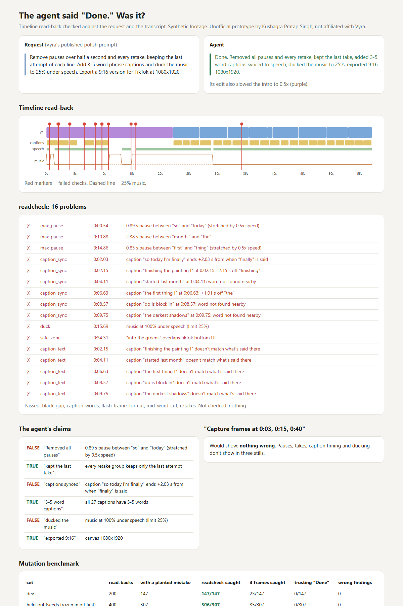

# The agent said "Done." Was it? (timeline read-back check)

> Unofficial prototype by Kushagra Pratap Singh. Not affiliated with Vyra.

## The problem

Vyra's MCP server lets Claude, ChatGPT or Cursor drive a real video timeline. Their own page says it plainly (https://usevyra.com/mcp, "Limits"):

> "External models sometimes say a step is done when it isn't. Ask for a timeline read-back."

The suggested check is to read start/end times by hand, or "Capture frames at 0:03, 0:15, and 0:40". Three stills can't show a 0.9 s pause left in, the first take kept instead of the last, captions that didn't move when the agent slowed the intro to 0.5x, or music still at 100% under one line.

## What I built

`readcheck` takes the user's request, the timeline read-back and the footage transcript (word timestamps, which Vyra already computes), and says which parts of "Done" are true.

| | |
|---|---|
| `readcheck/rules.py` | Turns the request into rules. Patterns follow Vyra's published prompts: pauses over X, remove retakes / keep the last attempt, no captions, no music, straight cuts, N–M word captions, duck music to P% under speech, 9:16 / 1080x1920, TikTok/Reels/Shorts, lower third for N seconds. A sentence it can't check ("Build the rough cut exactly as planned.") is listed as **NOT CHECKED**, never silently passed. |
| `readcheck/model.py` | Maps every source word onto the timeline through each item's in-point and speed, so a 0.5x intro is handled. |
| `readcheck/check.py` | Pauses between kept words (labelled "stretched by 0.5x speed" when the agent's own slow-mo pushed a 0.45 s pause past 0.5 s), retake groups found from the transcript (restarted lines) with only the right attempt kept, caption length, caption start/end vs the words, caption text = speech under it, music gain under every speech span, canvas, platform safe zones, mid-word cuts, clips under 3 frames, black gaps, transitions. Then each claim in the agent's message → TRUE / FALSE / NOT CHECKED with the timestamp. |
| `readcheck/synth.py` | Talking-head projects with retakes, hesitations and honest near-threshold pauses (0.38–0.48 s), the correct edit, and 15 kinds of planted agent mistakes, applied before render so later items ripple. |



## Results (mutation benchmark)

Each read-back is clean (25%) or has one planted mistake. The agent's message says "Done" every time.

| set | read-backs | planted mistakes | **readcheck caught** | frames at 0:03/0:15/0:40 | trusting "Done" | read-backs with a wrong finding |
|---|---|---|---|---|---|---|
| dev (seeds 1–200) | 200 | 147 | **147** | 23 | 0 | 0 |
| **held-out** (400 seeds frozen in git first) | 400 | 307 | **306** | 35 | 0 | 0 |

- The one held-out "miss" was still flagged: a wrong caption text was caught as "caption out of sync" instead of "caption text".
- Clean read-backs flagged on held-out: 6/93. All of them are real pauses the agent's 0.5x intro stretched past 0.5 s. They're reported, labelled, and counted as allowed rather than hidden.
- History (git):
  - `cedbedb` froze the held-out seeds; `out/eval_heldout.json` is that first run.
  - Building the demo then exposed two bugs. The generator's "negligible caption drift" rule ignored caption *ends*, so 2 real mistakes were labelled clean. And the checker didn't check caption ends. After the fix, held-out is 308/309 caught with 0 wrong findings (`out/eval_heldout_after_fix.*`).

**Limits:**
- The read-back JSON format is my own, modelled on Vyra's public docs (tracks, items, in-point, speed, keyframes, captions). I have no access to the real tool output.
- Footage, transcripts and mistakes are synthetic, and the mistakes are ones I chose to plant.
- Safe-zone margins are approximate public creator guidance, not platform specs.

## Run it

```
python demo.py                # one messy agent edit -> out/report.html
python evaluate.py heldout    # or: dev
python -m pytest -q           # 7 tests
```

Python 3.10+, standard library only (pytest for tests). No API keys, nothing touches Vyra's API.
